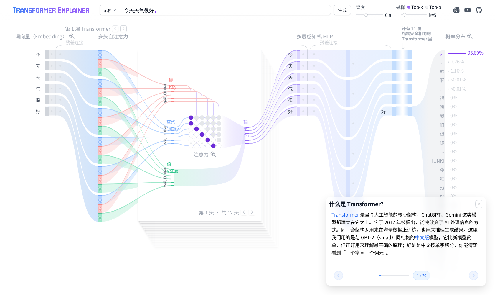
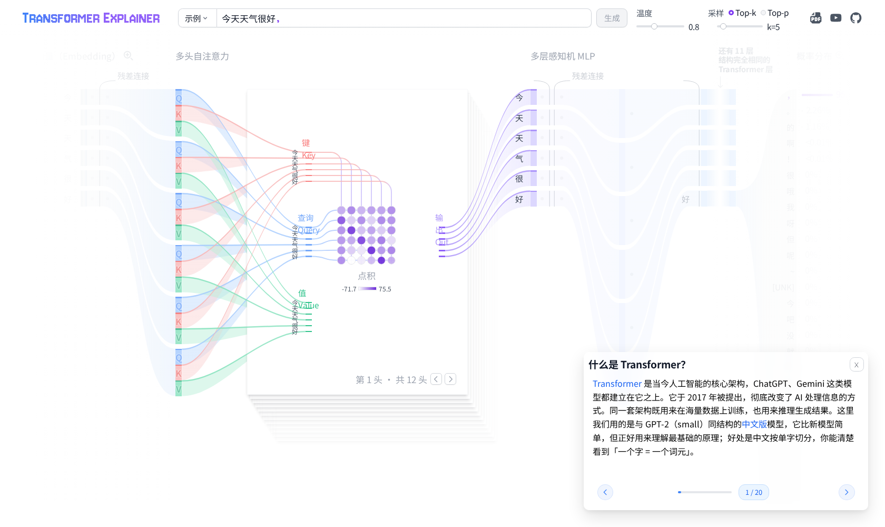
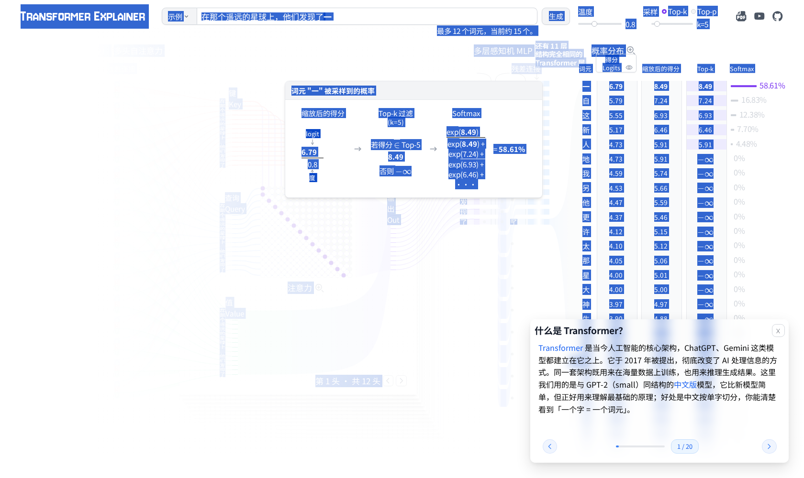

# Transformer Explainer · 本地完整复刻 · 中文版

这是 [Polo Club / Georgia Tech 的 Transformer Explainer](https://poloclub.github.io/transformer-explainer/) 的本地完整复刻：**不是重新设计，也不是静态截图**，而是把上游的 Svelte 交互界面、GPT-2 真实推理、注意力矩阵、概率分布、Block 动画和 20 页教材原样跑起来。

在完整复刻的基础上，界面已经全面中文化（面向大众展览），并且**换成了中文模型**：输入中文，一个字就是一个词元，注意力矩阵的每一行每一列都是你能读懂的汉字。布局与交互逻辑仍然未改。



## 直接运行

```bash
git clone https://github.com/CDUT-AI-Club/transformer-explainer.git
cd transformer-explainer
npm install --legacy-peer-deps
BASE_PATH='' npm run build
./start.sh
```

打开终端里打印的地址：**http://127.0.0.1:4173/**

首次打开会加载 456 MB 的中文模型权重（本机约 10 秒），之后浏览器会从 Cache Storage 读取，约 5 秒进入可交互状态。

> 运行期不需要联网。模型分片、tokenizer、ONNX Runtime WASM、字体、KaTeX 全部从本地 `static/` 读取。

### 获取模型

模型权重体积较大（456 MB），且 `uer/gpt2-chinese-cluecorpussmall` 目前**没有 license 标签**，
因此**不随本仓库分发**，`static/model-zh/` 已被 `.gitignore` 排除。克隆后该目录为空，页面会一直停在加载态。
补齐方式二选一：

1. **从内部/团队渠道拷贝**已经分片好的 46 个文件到 `static/model-zh/`（`gpt2-zh.onnx.part0` … `part45`）。
2. **自己导出**：用 `optimum-cli export onnx` 或 `torch.onnx.export` 把
   [`uer/gpt2-chinese-cluecorpussmall`](https://huggingface.co/uer/gpt2-chinese-cluecorpussmall) 导出成 ONNX，
   再按 10 MB 切成 `gpt2-zh.onnx.part<N>`。

> 授权提醒：对外发布或商用前请先按 [docs/uer-license-request.md](docs/uer-license-request.md) 拿到版权方书面许可。


## 操作说明

| 功能 | 怎么玩 |
|---|---|
| 生成下一个词 | 输入中文（最多 12 个**词元**，即 12 个汉字）或点「示例」，再点 **生成**；一个字就是一个词元 |
| 看真实注意力 | 点 `第 1 头 · 共 12 头` 两侧箭头切换 12 个头；点 `第 1 层 Transformer` 两侧箭头切换 12 层 |
| 展开计算过程 | 点 **词向量** / **多头自注意力** / **多层感知机** 标题，展开 Q/K/V、点积、掩码、Softmax 矩阵 |
| 温度 | 拖 **温度**，概率分布实时变平 / 变尖 |
| 采样 | 切 **Top-k / Top-p**，再拖采样滑块 |
| 逐词概率 | 右侧 **概率分布** 给出真实 softmax 概率 |
| 教材 | 点各处的 `?`，或右下角紫色书本按钮，翻 20 页图文讲解 |
| 长文 | 页面往下滚，是完整的 Transformer 图文长文（含公式、架构图、作者信息） |





## 中文化进度

### 已完成

- **全站界面文案**：工具区、注意力矩阵、概率分布、温度/采样、所有权重弹层、教材 20 页、页面下方长文、`<title>`/meta 全部中文。运行时扫描整个工具区，剩下的英文只有 4 类且都是刻意保留：品牌字 `TRANSFORMER EXPLAINER`、表示法 `Q/K/V`、通用符号 `Top-k`/`Top-p`/`Softmax`、以及权重矩阵的产品名。
- **中文字体**：打包 `Noto Sans SC` 400/700 两个子集（各约 1.1 MB，`static/fonts/`），改成 CJK 优先字体栈；`Jersey 10` 只留给左上角品牌字。离线环境下展览机没有中文字体也不会出现方块。
- **输入法修复**：加了 `isComposing` / `compositionstart` 守卫。此前用中文输入法时按回车选词会误触发生成，拼音未上屏时也会拿半截拼音去推理。
- **词元计数**：提示文字与上限改为按**词元**计，不再是空格数，否则整段中文会被放进去把注意力矩阵撑爆。

### 中文模型（重点）

原来的 GPT-2 词表 50,257 个词元里只有 **8 个**整字中文，`人工智能` 会被切成 8 个 UTF-8 字节碎片。现在换成
[`uer/gpt2-chinese-cluecorpussmall`](https://huggingface.co/uer/gpt2-chinese-cluecorpussmall)：

| 项 | 原 GPT-2 | 现在的中文模型 |
|---|---|---|
| 词表 | 50,257（字节级 BPE） | **21,128**（字符级 WordPiece，7,321 个汉字，一字一项） |
| `人工智能` | 8 个字节碎片 | **4 个词元**：`人` `工` `智` `能` |
| `数据可视化让用户` | 19 个碎片 | **8 个词元** |
| 架构 | 12 层 / 12 头 / 768 维 | **完全一致** → 所有可视化组件零改动 |
| 参数 / 权重 | 124M / 657 MB | 101M / **456 MB** |
| 推理 | — | CPU + WASM **约 205 ms** 一次 |

**关键实现点**（换模型之所以能"零改动"，靠的是这几点对齐）：

1. **ONNX 输出布局完全沿用**：`model.py` 本来就是 nanoGPT 的改造版，会吐出 721 个张量
   （`block_{i}_attn_head_{j}_attn` / `_scaled` / `_masked` / `_softmax` / `_dropout` + `linear_output`）。
   中文模型同构，所以只需重建 model、灌入权重，输出名一个都不用改。
2. **分词器要自己造**：UER 只发布 BERT 风格的 `vocab.txt`，没有 `tokenizer.json`。
   `@xenova/transformers` 必须要后者，所以用 `tokenizers` 生成了一份
   （`BertNormalizer(lowercase=True)` + `BertPreTokenizer` + `WordPiece`）。
   **特意去掉了 `[CLS]`/`[SEP]`**：这是因果语言模型，多加两个特殊符号会让位置整体错开、
   还在每个注意力矩阵里塞进两行无意义的格子。
3. **`##` 前缀在显示层剥掉**：WordPiece 用 `##` 标记子词续接，不处理的话汉字会显示成 `##人`。
4. **词表大小不再写死**：弹层里的 `50,257`、教材和长文里的数字都改成跟随 `modelMeta.vocab_size`。
5. **缓存名升级**：`onnx-model-cache-v2` → `-zh-v1`，否则浏览器会把英文权重喂给新会话。
6. **示例缓存重新生成**：5 份 `ex*.js` 用同一套权重和分词器重算，加载那几秒和加载完看到的是一致的。

### 已知限制

- **中文生成质量弱于同规模英文模型**。UER 这个模型在 CLUECorpusSmall 上训练，能产出通顺的中文
  （实测 `人工智能正在改变我们` → `…的生活、提高我们的社会、`），但不如 GPT-2 英文流畅，偶尔会跑偏。
  好在界面上本来就有**温度 / Top-k / Top-p** 三个控件，讲解时正好可以演示"温度调低它就变保守"。
- **模型授权未确认**。该模型卡没有 license 标签，默认是保留所有权利。展会/对外发布前请按
  [docs/uer-license-request.md](docs/uer-license-request.md) 拿到作者书面许可。
- 中文模型**不认大写英文**（词表只有小写），`Transformer` 会被拆成 `t`+`##ran`+… 或 `[UNK]`；
  展台以中文为主，影响不大。

## 和上游的差别

除了中文化，只做了“让它能在本机离线跑”的改动，布局和交互逻辑没有改：

- 英文 GPT-2 的 63 个分片曾完整下载到 `static/model-v2/`；现在运行的是中文模型 `static/model-zh/`（46 个分片，456 MB，**未随仓库分发**），旧分片已从构建产物中移除。
- tokenizer 改从本地 `static/tokenizer-zh/` 读取（含自行生成的 `tokenizer.json`），不再访问 HuggingFace。
- ONNX Runtime WASM 改从本地 `static/ort/` 读取，不再访问 jsDelivr。
- Jersey 10 字体、Noto Sans SC 字体、KaTeX 字体改成本地文件。
- 生产构建的 `base` 改为可用 `BASE_PATH` 控制；本地默认根路径。
- 关掉 SSR（这个应用本来就只能在浏览器里跑），并修正了 Linux 下大小写敏感的 `Popovers` 导入路径。
- Vite 升到 7，以匹配上游锁定的 `@sveltejs/vite-plugin-svelte` 6。

## 重新构建

```bash
npm install --legacy-peer-deps
BASE_PATH='' npm run build
python3 serve.py
```

`npm install` 必须带 `--legacy-peer-deps`（上游的 `package-lock.json` 本身就是在这个模式下生成的）。

## 目录

```
transformer-explainer/
├── src/                  # 上游 Svelte 源码
├── static/
│   ├── model-zh/         # 中文 GPT-2 ONNX 的 46 个分片（456 MB，需自行放置，见「获取模型」）
│   ├── tokenizer-zh/     # 中文字符级 tokenizer（含生成的 tokenizer.json）
│   ├── model-v2/         # 英文 GPT-2 分片（已不参与构建）
│   ├── ort/              # onnxruntime-web WASM
│   ├── fonts/            # Jersey 10 + Noto Sans SC（中文字体）
│   └── katex/            # KaTeX 样式与字体
├── build/                # 已构建好的静态站点（start.sh 直接服务它）
├── serve.py              # 多线程静态服务器（63 个分片并发加载）
└── start.sh              # 一键启动
```

## 许可与 credit

上游项目：[poloclub/transformer-explainer](https://github.com/poloclub/transformer-explainer)，MIT License。
论文：Cho et al., *Transformer Explainer: Learning LLM Transformers with Interactive Visual Explanation and Experimentation*, CHI 2026。

本目录只是把上游完整搬到本地并补齐离线资源；界面、交互与视觉设计版权归原作者所有。
