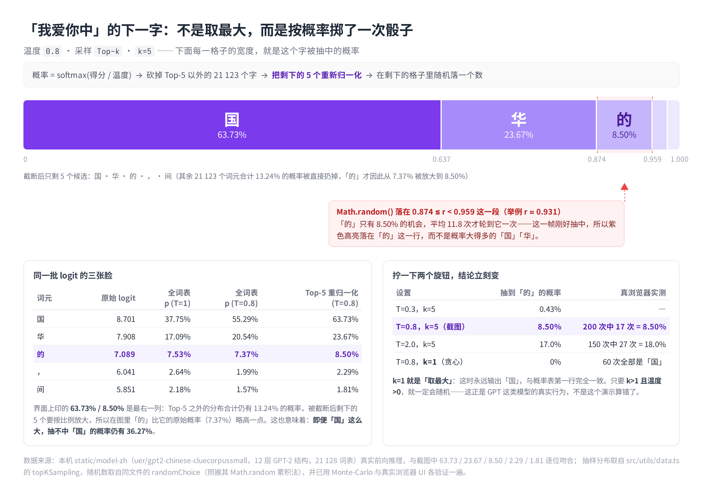

# 为什么「国 / 华」概率最大，演示却选了「的」？

一句话：**这个演示不是取最大值，而是按概率掷骰子。**紫色高亮标的是「这一次掷出来的结果」，不是「概率最高的那个」。



## 1. 代码里确实就是随机抽样

`src/utils/data.ts` 的 `topKSampling()`（第 299 行）做完温度缩放和 Top-k 截断后，最后一行是：

```ts
const sampled = randomChoice(output);   // 第 340 行
```

`randomChoice()`（第 430 行）就是 `np.random.choice` 的等价实现：取一个 `Math.random()`，
按累积概率落到哪一格就返回哪个词元。**没有任何一步在挑最大值**。
`src/components/ProbabilityBars.svelte` / `LinearSoftmax.svelte` 里被染成紫色的行，
用的正是 `$predictedToken.rank === idx`，即「本次抽样结果」，而不是 `rank === 0`。

## 2. 截图里的五个数字是「条件概率」，不是模型的原始输出

本机 `static/model-zh`（uer/gpt2-chinese-cluecorpussmall，12 层 GPT-2、21 128 词表）
对 `我爱你中` 真实前向推理后，最后一个位置的分布（T = 温度）：

| 词元 | logit | 全词表 p (T=1) | 全词表 p (T=0.8) | Top-5 重归一化 (T=0.8) |
|---|---|---|---|---|
| 国 | 8.701 | 37.75% | 55.29% | **63.73%** |
| 华 | 7.908 | 17.09% | 20.54% | **23.67%** |
| 的 | 7.089 | 7.53% | 7.37% | **8.50%** |
| ， | 6.041 | 2.64% | 1.99% | **2.29%** |
| 间 | 5.851 | 2.18% | 1.57% | **1.81%** |

界面上的 `63.73 / 23.67 / 8.50 / 2.29 / 1.81` 与最后一列**逐位吻合**，说明：
- 温度确实是 0.8（先除以 0.8 再 softmax）；
- Top-5 以外还有 13.24% 的概率质量被直接丢掉，剩下的 5 个按比例放大，
  所以「的」从真实概率 7.37% 被放大成 8.50%。

（对比：如果按 T=1 且不截断，原始概率是 37.75 / 17.09 / 7.53……，与截图对不上。）

## 3. 为什么这不是 bug：理论依据

这是 GPT 系列一贯的解码方式，不是这个可视化写错。

1. **温度缩放**（Hinton 等提出的 softmax temperature；GPT-2 论文与所有 API 都有 `temperature`）：
   `p_i = softmax(z_i / T)`。T < 1 让分布变尖，T > 1 让分布变平。
   这里 T = 0.8 < 1，所以分布已经被「调尖」过——但再尖也不会变成 0。
2. **Top-k 截断**（Fan, Lewis & Dauphin, *Hierarchical Neural Story Generation*, arXiv:1805.04833）：
   只保留概率最大的 k = 5 个候选，并把它们的概率重新归一化。
3. **多项分布采样**：在剩下的候选里按概率抽一个（本项目的 `randomChoice`）。
   「国」的抽样概率是 63.73%，所以 **抽不中「国」的概率高达 36.27%**；
   「的」是 8.50%，平均每 11.8 次抽一次。
4. Holtzman 等（*The Curious Case of Neural Text Degeneration*, arXiv:1904.09751）
   进一步说明：最大化式解码（greedy / beam）会产生退化、重复的文本，
   所以现代 LLM 默认用 top-k / top-p 这类截断采样来保持多样性。

而且 `我爱你中` → `的` 本来就是**合法的中文**（「我爱你中的每一个人……」），
模型给它的真实概率有 7.37%，并不是一个「不可能的字符」。

## 4. 实测验证

三种独立方法都得到同一个结论（k=5、T=0.8）：

| 方法 | 结果 |
|---|---|
| 用 `topKSampling` 的概率表做 100 万次 Monte-Carlo | 国 63.66% / 华 23.72% / **的 8.53%** / ，2.27% / 间 1.82% |
| 真实浏览器里连续触发 200 次抽样（拖动温度滑块回到 0.8 即重抽一次） | 国 67.5% / 华 20.5% / **的 8.50%（17 次）** / ，3.0% / 间 0.5% |
| 把 k 调成 1（等价于贪心 / argmax）连抽 60 次 | **全部是「国」** |
| 把温度调到 2.0（其余不变）抽 150 次 | 国 39.3% / 华 29.3% / **的 18.0%** |

即：**k=1 时它一定选「国」；只要 k>1 且温度>0，就按概率随机。**
你看到选了「的」，只是碰上了那 8.5% 的一支。

## 5. 想让它「选概率最大的」怎么办

- 把 **采样 Top-k 的 k 调到 1** → 退化成贪心解码，永远输出「国」；
- 或把 **温度调到最低（0.2）** → 「国」的抽样概率升到 98.1%，几乎总是它。

## 复现方法

```bash
# 1) 合并模型分片（只需一次，约 456MB）
cd static/model-zh && ls gpt2-zh.onnx.part* | sort -V | xargs cat > /tmp/gpt2-zh.onnx

# 2) 跑一次真实前向，并按 App 的 topKSampling 重算概率表
node --input-type=module -e '
import fs from "node:fs";
import { createRequire } from "node:module";
const require = createRequire(import.meta.url);
const ort = require("./node_modules/onnxruntime-node");
const tok = JSON.parse(fs.readFileSync("./static/tokenizer-zh/tokenizer.json", "utf8"));
const id2tok = new Map(Object.entries(tok.model.vocab).map(([t, i]) => [i, t]));
const ids = [..."我爱你中"].map((c) => tok.model.vocab[c]);
const s = await ort.InferenceSession.create("/tmp/gpt2-zh.onnx");
const r = await s.run({ input: new ort.Tensor("int64", BigInt64Array.from(ids.map(BigInt)), [1, ids.length]) });
const d = r["linear_output"], V = d.dims.at(-1), T = d.dims.at(-2);
const logits = Array.from(d.data.slice((T - 1) * V, T * V), Number);
const soft = (l) => { const m = Math.max(...l); const e = l.map((x) => Math.exp(x - m)); const z = e.reduce((a, b) => a + b, 0); return e.map((v) => v / z); };
const order = logits.map((l, i) => ({ i, l })).sort((a, b) => b.l - a.l).slice(0, 5);
const full = soft(logits.map((l) => l / 0.8));            // 温度 0.8
const mass = order.reduce((a, o) => a + full[o.i], 0);     // Top-5 质量
order.forEach((o, k) => console.log(id2tok.get(o.i), ((full[o.i] / mass) * 100).toFixed(2) + "%"));
// 期望输出：国 63.73% / 华 23.67% / 的 8.50% / ，2.29% / 间 1.81%
'
```

其他佐证见同目录 `what-was-wrong-generation.md`（那是另一类问题的调试记录）。
